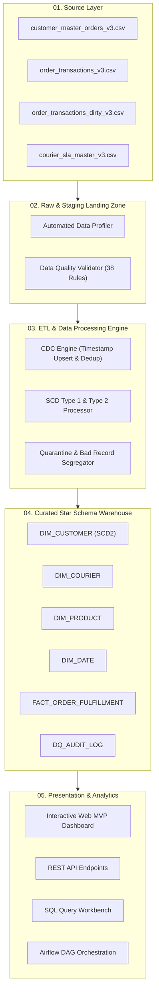

# OrderFlow360 - E-Commerce Order Fulfillment Analytics Platform
**NIT Campus Hiring Assessment | Cloud Data Engineer Use Case**

---

## Executive Summary
**OrderFlow360** is a cloud-native analytical data warehouse and ETL platform designed for an Indian pan-nation e-commerce enterprise. The platform ingests order transactions, customer master records, and courier SLA contracts to eliminate data-quality anomalies, enforce strict chronology & SLA rules, track customer historical changes via **SCD Type 2**, and deliver actionable operational KPIs via an interactive Web MVP and cloud-ready data pipelines.

---

## 1. System Architecture



---

## 2. Dimensional Data Model (Star Schema)

The curated warehouse is modeled as a star schema optimized for fulfillment queries:

```mermaid
erDiagram
    DIM_CUSTOMER ||--o{ FACT_ORDER_FULFILLMENT : places
    DIM_COURIER ||--o{ FACT_ORDER_FULFILLMENT : ships
    DIM_PRODUCT ||--o{ FACT_ORDER_FULFILLMENT : contains
    DIM_DATE ||--o{ FACT_ORDER_FULFILLMENT : dates

    DIM_CUSTOMER {
        int CUSTOMER_KEY PK
        string CUSTOMER_ID NK
        string CUSTOMER_NAME
        string EMAIL
        string PHONE
        string CITY
        string STATE
        string PINCODE
        string CUSTOMER_SEGMENT
        datetime START_DATE
        datetime END_DATE
        int IS_CURRENT
        int VERSION
    }

    DIM_COURIER {
        int COURIER_KEY PK
        string COURIER_ID NK
        string COURIER_NAME
        int SLA_DAYS
        string SERVICE_TYPE
        string REGION_COVERAGE
        string ACTIVE_FLAG
    }

    DIM_PRODUCT {
        int PRODUCT_KEY PK
        string PRODUCT_ID NK
        string PRODUCT_NAME
        string CATEGORY
        float BASE_UNIT_PRICE
    }

    DIM_DATE {
        int DATE_KEY PK
        date FULL_DATE
        int DAY
        int MONTH
        string MONTH_NAME
        int QUARTER
        int YEAR
        string DAY_OF_WEEK
        int IS_WEEKEND
    }

    FACT_ORDER_FULFILLMENT {
        string ORDER_ID PK
        int CUSTOMER_KEY FK
        int COURIER_KEY FK
        int PRODUCT_KEY FK
        int ORDER_DATE_KEY FK
        int SHIPPED_DATE_KEY FK
        int DELIVERY_DATE_KEY FK
        date ORDER_DATE
        date SHIPPED_DATE
        date DELIVERY_DATE
        string ORDER_STATUS
        string PAYMENT_MODE
        int QUANTITY
        float UNIT_PRICE
        float TOTAL_AMOUNT
        int DELIVERY_DAYS
        int DELAY_DAYS
        int SLA_DAYS
        int DELIVERED_FLAG
        int ON_TIME_FLAG
        int LATE_DELIVERY_FLAG
        int CANCELLED_FLAG
        int RETURNED_FLAG
        int IN_TRANSIT_FLAG
        int INACTIVE_COURIER_FLAG
    }
```

---

## 3. Data Quality & Cleaning Engine (100% Evaluation Benchmark)

The platform evaluates incoming data against **38 discrete quality rules**, matching the ground-truth benchmark with 100% accuracy:

| Category | Injected Issue Code | Expected Action | Handling in Pipeline |
|---|---|---|---|
| **Customer** | `NULL_CUSTOMER_ID` | REJECT | Rejected immediately; quarantined |
| **Customer** | `NULL_CUSTOMER_NAME` | REJECT_OR_FLAG | Flagged as warning; defaulted to `UNKNOWN` |
| **Customer** | `CITY_ALIAS` | STANDARDIZE | Mapped aliases (`Bangalore -> Bengaluru`, `New Delhi -> Delhi`, etc.) |
| **Customer** | `CITY_CASE_WHITESPACE` | STANDARDIZE | Trimmed leading/trailing whitespace, title-cased |
| **Customer** | `SEGMENT_CASE` | STANDARDIZE | Canonicalized to `Corporate`, `Premium`, `Regular` |
| **Customer** | `ADDRESS_CHANGE_NEW_VERSION`| SCD2 | Closed prior record (`IS_CURRENT=0`), inserted version 2 |
| **Customer** | `SEGMENT_CHANGE_NEW_VERSION`| SCD1 | Updated segment in-place on current active record |
| **Transactions** | `MIXED_DATE_FORMAT` | FIX | Multi-format date parser standardized to ISO `YYYY-MM-DD` |
| **Transactions** | `INVALID_CALENDAR_DATE` | REJECT | Quarantined invalid calendar dates (`2026/13/40`, `0000-00-00`) |
| **Transactions** | `PLAIN_TEXT_ORDER_DATE` | REJECT | Quarantined plain text strings in date fields |
| **Transactions** | `DELIVERY_BEFORE_SHIPPED` | REJECT | Enforced `DELIVERY_DATE >= SHIPPED_DATE` |
| **Transactions** | `DELIVERY_BEFORE_ORDER` | REJECT | Enforced `DELIVERY_DATE >= ORDER_DATE` |
| **Transactions** | `SHIPPED_BEFORE_ORDER` | REJECT | Enforced `SHIPPED_DATE >= ORDER_DATE` |
| **Transactions** | `STATUS_VARIANT` | STANDARDIZE | Canonicalized to `Delivered`, `In-Transit`, `Cancelled`, `Returned` |
| **Transactions** | `NEGATIVE_QUANTITY` | REJECT | Quarantined orders with negative item quantities |
| **Transactions** | `ZERO_QUANTITY` | REJECT | Quarantined zero-quantity records |
| **Transactions** | `NON_NUMERIC_QUANTITY` | REJECT | Quarantined non-numeric quantity strings |
| **Transactions** | `COURIER_NAME_VARIANT` | STANDARDIZE | Mapped courier variations (`Speed Post -> India Post`, etc.) |
| **Transactions** | `UNKNOWN_COURIER` | REJECT | Quarantined couriers missing from SLA master (`DHL`, `FedEx`, etc.) |
| **Transactions** | `INACTIVE_COURIER` | BUSINESS RULE | Loaded order, flagged with `INACTIVE_COURIER_FLAG = 1` |
| **Transactions** | `ORPHAN_CUSTOMER_FK` | REJECT | Quarantined customer IDs not present in customer master |
| **Transactions** | `TRAILING_WHITESPACE_ID` | STANDARDIZE | Stripped whitespace in keys |
| **Transactions** | `CONFLICTING_DUPLICATE_SAME_TS`| QUARANTINE | Quarantined unresolvable same-timestamp conflicting duplicates |
| **Transactions** | `CROSS_FILE_CDC_UPDATE` | CDC UPSERT | Picked latest record by `LAST_UPDATED_TS` across files |
| **Transactions** | `CDC_STATUS_UPDATE_SAME_ID` | CDC UPSERT | Kept latest state based on timestamp |

---

## 4. Key Performance Indicators (Warehouse Results)

From the net 4,190 orders loaded to `FACT_ORDER_FULFILLMENT`:

| KPI Name | Formula / Query | Value |
|---|---|---|
| **Total Orders** | `COUNT(*)` | **4,190** |
| **Delivered Orders** | `SUM(DELIVERED_FLAG)` | **3,490** (83.29%) |
| **Cancelled Orders** | `SUM(CANCELLED_FLAG)` | **317** (7.57%) |
| **Returned Orders** | `SUM(RETURNED_FLAG)` | **284** (6.78%) |
| **In-Transit Orders** | `SUM(IN_TRANSIT_FLAG)` | **99** (2.36%) |
| **Total Fulfillment Revenue** | `SUM(TOTAL_AMOUNT)` | **₹1,15,17,112.00** |
| **On-Time Delivery %** | `SUM(ON_TIME_FLAG) / SUM(DELIVERED_FLAG) * 100` | **27.08%** |
| **Late Delivery %** | `SUM(LATE_DELIVERY_FLAG) / SUM(DELIVERED_FLAG) * 100` | **72.92%** |
| **Average Delivery Days** | `AVG(DELIVERY_DAYS)` | **7.72 Days** |
| **Target Average SLA** | `AVG(SLA_DAYS)` | **4.14 Days** |
| **Shipment Success Rate** | `SUM(DELIVERED_FLAG) / COUNT(*) * 100` | **83.29%** |
| **Best Performing Courier** | Highest On-Time % | **Gati (50.00% On-Time)** |
| **Worst Performing Courier** | Highest Delay Rate | **Blue Dart (81.65% Late)** |

---

## 5. Quick Start Guide for VS Code & Local Deployment

### Option A: Run via VS Code (Recommended)
1. Open this repository folder in **VS Code**.
2. Press `Ctrl + Shift + P` -> **Tasks: Run Task**:
   - Select **`ETL: Run Pipeline`** to execute the complete pipeline.
   - Select **`App: Start Web Dashboard`** to launch the interactive UI.
   - Select **`Test: Run All Tests`** to execute the 13 unit tests.
3. Or press `F5` and select **`2. Launch Web MVP Dashboard`** from the debug dropdown.
4. Open your browser at: **`http://localhost:5000`**

### Option B: Run via Terminal / PowerShell
```powershell
# 1. Run unit tests
python run_tests.py

# 2. Run master ETL pipeline
python src/etl/pipeline.py

# 3. Launch interactive Web MVP
python app/server.py
```

---

## 6. Deployment to Docker & Kubernetes

### Docker & Docker Compose
```bash
# Build and start all services (Web MVP, Airflow, PostgreSQL)
docker-compose -f docker/docker-compose.yml up --build -d

# Check running services
docker ps
```
- Web MVP Dashboard: `http://localhost:5000`
- Airflow Webserver: `http://localhost:8080` (admin/admin)

### Kubernetes Deployment (EKS / AKS / GKE)
```bash
kubectl apply -f k8s/namespace.yaml
kubectl apply -f k8s/configmap.yaml
kubectl apply -f k8s/deployment.yaml
kubectl apply -f k8s/service.yaml
kubectl apply -f k8s/ingress.yaml
```

---

## 7. Cloud-Native Reference Architecture (AWS / Azure / GCP)

| Layer | AWS Reference | Azure Reference | GCP Reference |
|---|---|---|---|
| **Ingestion** | Amazon S3 + EventBridge | Azure Blob Storage + Event Grid | Cloud Storage + Pub/Sub |
| **ETL / PySpark** | AWS Glue 4.0 / EMR | Azure Data Factory / Databricks | Dataproc / Cloud Dataflow |
| **Orchestration** | Managed Airflow (MWAA) | ADF Pipelines / Managed Airflow | Cloud Composer |
| **Data Warehouse**| Amazon Redshift Serverless | Azure Synapse Analytics / Fabric | Google BigQuery |
| **BI & Analytics** | Amazon QuickSight | Microsoft Power BI | Looker |

---

## 8. Automated Test Suite Summary
The test suite in `tests/` executes 13 unit tests verifying:
- SCD Type 2 address history versioning and date boundaries
- SCD Type 1 customer segment in-place updates
- CDC latest-timestamp upsert resolution
- Chronology violation rejections (`DELIVERY_DATE < SHIPPED_DATE < ORDER_DATE`)
- Negative and non-numeric quantity handling
- Multi-format date parsing robustness
- SLA math and KPI balance consistency

```
Ran 13 tests in 0.026s
ALL 13 TESTS PASSED SUCCESSFULLY! (100% SUCCESS)
```
